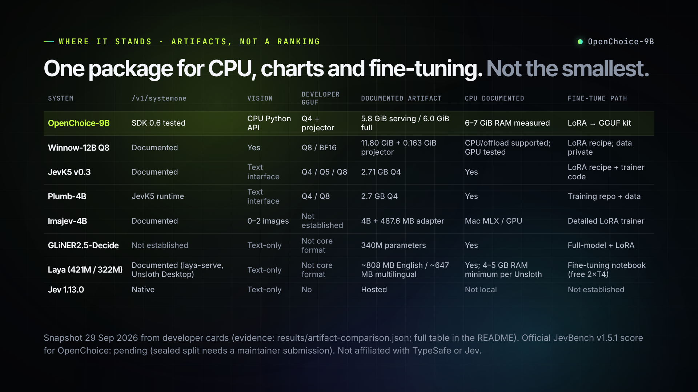

# OpenChoice-9B

**CPU-first multimodal System-One-compatible decisions: no GPU required.** About **5.8 GiB of serving weights**, **6–7 GiB RAM**, optional GPU offload, and a built-in **LoRA → GGUF** fine-tuning kit (tested on a 24 GB GPU).

OpenChoice-9B is Qwen/Qwen3.5-9B plus a rank-16 LoRA decision adapter, merged into **GGUF Q4_K_M**. It returns probabilities, not generated answer text: **Choice** (1–26 options), **Score** (1–10 ordered levels), and **Noul** (probability a statement is true). The HTTP service implements the TypeSafe SDK 0.6-compatible `POST /v1/systemone` format. This is an independent project, not Jev or a TypeSafe product.

The text GGUF is **5.24 GiB** (5.63 decimal GB), with a **595 MiB vision projector**. Together they are about **5.8 GiB**; the complete download is about **6.0 GiB** including the tokenizer and retained training adapter. It is a 9B-parameter model. Source, runtime, and model-package licensing are separate; see [License and attribution](#license-and-attribution) before redistributing weights.



## What OpenChoice is built for, and when to use something else

Official JevBench v1.5.1 results for OpenChoice are pending, so this is not a quality ranking. The first three rows are what OpenChoice is designed and optimized for; we'll publish benchmark results for them as they come in. The rest are cases where another model is the better fit today.

| Your situation | Pick | Why |
|---|---|---|
| Long inputs: contracts, ticket threads, agent traces, policies | **OpenChoice: design goal** | 4,096 tokens per forward and 32,768 per decision, no silent truncation; small encoders read 512–1,024 tokens by default |
| Decisions that include an image (charts) on a machine without a GPU, via the Python engine | **OpenChoice: design goal** | The vision projector runs on CPU; most CPU-first decision models are text-only. The HTTP API is text-only, and only synthetic charts have been evaluated so far |
| Your own labels or house rules the model can't guess | **OpenChoice: design goal** | Built-in LoRA fine-tune that exports back to the same GGUF server; the included tutorial went from 28/64 to 61/64 on held-out rows |
| Short-text routing or tagging on any laptop, smallest footprint | Laya (one-click via [Unsloth Desktop](https://unsloth.ai/docs/models/decision-laya)) or GLiNER2.5-Decide | Far smaller: Laya ~0.6–0.8 GB weights and 4–5 GB RAM minimum per Unsloth, GLiNER2.5-Decide 340M parameters; OpenChoice needs 6–7 GiB RAM |
| Many languages | Laya multilingual | 100+ languages; OpenChoice is English-centric |
| Smallest GGUF with a published JevBench v1.5.1 score | JevK5 v0.3 or Plumb-4B | 2.7 GB Q4 GGUFs with official composites 71.9 / 71.6 |
| Higher published accuracy, cloud acceptable | Jev, or Cygnet / Winnow-12B (v1.5.1 composites 72.1 / 73.7 / 73.2) | OpenChoice trails Jev on every aggregate benchmark we compared; its official v1.5.1 score is pending |
| You need explanations or free-form output | A generative model (e.g. Winnow, which also serves chat) | OpenChoice returns probabilities only |

Details and sources for each alternative are in [Current alternatives](#current-alternatives-artifacts-not-a-quality-ranking).

## Quickstart

### Docker (CPU, Linux containers; verified on Linux/amd64)

Use Docker Engine on Linux or Docker Desktop with **Linux containers** on macOS/Windows. Allocate at least **12 GiB RAM to the Docker VM**; **16 GiB total system RAM is recommended**, not a tested minimum. Allow about 6.0 GiB for the model, plus image/build storage. Model: [huggingface.co/lutr0/OpenChoice-9B](https://huggingface.co/lutr0/OpenChoice-9B).

The following single-line commands work in a POSIX shell or **PowerShell 7.3+**. To skip the local build, replace the first three lines with `docker pull ghcr.io/lutr0/openchoice:0.2.0-cpu` and `docker tag ghcr.io/lutr0/openchoice:0.2.0-cpu openchoice:cpu` (linux/amd64 runtime-tested; linux/arm64 smoke-tested under emulation only).

```sh
git clone https://github.com/lutr0/openchoice.git
cd openchoice
docker build -t openchoice:cpu .
docker volume create openchoice-model
docker run --rm --mount type=volume,source=openchoice-model,target=/models openchoice:cpu download lutr0/OpenChoice-9B
docker run --rm --entrypoint python openchoice:cpu -c "import secrets; print('OPENCHOICE_API_KEY=' + secrets.token_hex(32))" > openchoice.env
docker run -d --name openchoice --env-file openchoice.env -p 127.0.0.1:8768:8768 --mount type=volume,source=openchoice-model,target=/models,readonly openchoice:cpu
docker logs -f openchoice
```

Keep `openchoice.env` private; do not commit it. Wait for “Application startup complete” (hash verification plus warmup), then press Ctrl-C to stop following logs; the container stays running. `docker inspect --format '{{.State.Health.Status}}' openchoice` should report `healthy`. Stop/remove it with `docker rm -f openchoice`; the model volume persists.

Already downloaded the package? Replace the volume mount in the serving command with `--mount "type=bind,source=/absolute/path/OpenChoice-9B-GGUF,target=/models,readonly"` (Windows: use the actual drive-qualified path). Keep the model read-only while serving. Every package file must be readable by the container user; on Linux, add `--user "$(id -u):$(id -g)"` before the image name to use your non-root host UID when files are private to you. The optional `download` command needs a writable mount and accepts Hugging Face CLI options such as `--revision`; use the same UID override for downloading into a host directory you own. On SELinux hosts a bind-mounted directory may need an appropriate container file label; a named volume avoids host-label changes.

The image runs as UID/GID **10001**, CPU-only at nice 10, and binds `0.0.0.0:8768` **inside** the container. It therefore **requires `OPENCHOICE_API_KEY`**, even though the published host port is loopback-only. Do not replace `127.0.0.1:8768:8768` with an all-interface mapping on an untrusted network. Append `--threads N` after the image name to limit inference CPU use (default 12). Serving installs **no PyTorch, PEFT, bitsandbytes, CUDA wheels, compiler, or CMake**. Weights are mounted, never baked into the image; only the verified local package is loaded, never the full BF16 base.

### Native Linux (no Docker)

Requirements: Linux x86-64, [uv](https://docs.astral.sh/uv/), Git, Make and a C++17 compiler; uv supplies Python 3.12 and pinned CMake. Debian/Ubuntu: `sudo apt-get install git build-essential`; Fedora: `sudo dnf install git gcc-c++ make`. The same 16 GiB system-RAM recommendation applies.

```sh
git clone https://github.com/lutr0/openchoice.git
cd openchoice
bash scripts/build_llamacpp.sh
uv run hf download lutr0/OpenChoice-9B --local-dir ./OpenChoice-9B-GGUF
uv run python -m openchoice.server --model ./OpenChoice-9B-GGUF --port 8768
```

No separate `uv sync` step is needed. CPU is the default; no CUDA toolkit is required. The build pins llama.cpp `4364bf7232e65c34eca8d9500c5464389662de6b` and compiles the exact-logit bridge into `.runtime/`. Native builds optimize for the current CPU: do not copy them between machines. For portable Linux CPU kernels, use `PORTABLE=1 bash scripts/build_llamacpp.sh`; this is the container's build mode (`GGML_NATIVE=OFF`, dynamically selected `GGML_CPU_ALL_VARIANTS` backends). Build in the final runtime directory: the plugin search path is embedded (fixed at `/app/.runtime` in the image).

### Send a decision

In a second terminal in the checkout, load the container key (skip this for native serving without a key):

```sh
# POSIX shell
. ./openchoice.env
```

```powershell
# PowerShell 7.3+
$env:OPENCHOICE_API_KEY = (Get-Content ./openchoice.env).Split('=', 2)[1]
```

POSIX shell example (Choice, Score and Noul in one request):

```sh
curl --fail http://127.0.0.1:8768/health
curl --fail http://127.0.0.1:8768/v1/systemone -H "Authorization: Bearer $OPENCHOICE_API_KEY" -H 'Content-Type: application/json' -d '{"model":"openchoice-latest","state":"My card was charged twice. Please refund the duplicate payment.","questions":{"topic":{"type":"choice","instructions":"Classify the message.","criteria":{"billing":"Billing and refunds","weather":"Weather forecast"}},"severity":{"type":"score","instructions":"Rate the payment problem.","criteria":["No payment problem","A duplicate charge requiring a refund"]},"duplicate":{"type":"noul","instructions":"Was the customer charged twice?"}}}'
```

PowerShell 7.3+ uses `curl.exe` and its environment-variable syntax:

```powershell
curl.exe --fail http://127.0.0.1:8768/health
curl.exe --fail http://127.0.0.1:8768/v1/systemone -H "Authorization: Bearer $env:OPENCHOICE_API_KEY" -H 'Content-Type: application/json' -d '{"model":"openchoice-latest","state":"My card was charged twice. Please refund the duplicate payment.","questions":{"topic":{"type":"choice","instructions":"Classify the message.","criteria":{"billing":"Billing and refunds","weather":"Weather forecast"}},"severity":{"type":"score","instructions":"Rate the payment problem.","criteria":["No payment problem","A duplicate charge requiring a refund"]},"duplicate":{"type":"noul","instructions":"Was the customer charged twice?"}}}'
```

The response contains normalized `probabilities` for Choice/Score and a scalar `noul`, not generated answer text. `GET /v1/models` lists the concrete package identity. Native loopback binding makes the key optional; non-loopback binding requires it. Do not expose this development service to an untrusted network.

**Platforms and verification:** Linux/amd64 was built and run here: healthcheck, the curl above, and all **34 SDK smoke cases passed**. The image is **353 MiB** excluding weights and became healthy in **7.39 s** on the shared Ryzen desktop with warm filesystem caches. Linux/arm64 was **built and smoke-run under QEMU emulation only, not verified on Apple Silicon/native arm64 hardware**. Its 348 MiB image passed health and returned the README probabilities on both the default SVE/SME and Cortex-A76 emulated CPUs; **both full SDK runs exceeded the unchanged 180 s per-request timeout**. These emulation timings are not Apple Silicon performance measurements. macOS/Windows Docker Desktop host integration was not exercised; the native build path remains Linux-only.

**Numerical portability:** the amd64 container and native build chose the same billing class, but were not bit-identical: maximum absolute probability delta **0.0012598** (about **0.126 percentage points**) on this request. The container uses portable runtime-dispatched CPU variants (selected Zen 4, GCC 14.2) rather than the host's `GGML_NATIVE=ON` build (GCC 16.2); kernel/compiler effects were not separately isolated. Do not assume native benchmark probabilities are identical in a container. Digests, exact outputs, all platform smoke results and limitations are in [results/container-verification.json](results/container-verification.json).

The container is CPU-only: Docker Desktop does not provide Apple Metal acceleration, and **no CUDA container variant is provided**. Native NVIDIA offload is separate below.

### Optional NVIDIA offload

With a working CUDA toolkit and a compatible NVIDIA driver:

```sh
bash scripts/build_llamacpp.sh cuda
uv run python -m openchoice.server --model ./OpenChoice-9B-GGUF --gpu auto --port 8768
```

The CPU instance remains resident. Auto mode admits a second, **four-layer** GPU instance after 60 game-free seconds and at least 4 GiB reported free VRAM (2 GiB model allowance plus 2 GiB reserve). It releases that instance at a request boundary if a Linux Steam/Wine/Proton game is detected or free VRAM drops below 1 GiB. These checks are best-effort, not a GPU reservation or a guarantee against OOM. CUDA can retain a small driver context after the offload instance is released. CPU/GPU probabilities can differ. Images always use the CPU projector and CPU model. Do not use auto mode to compete with an already-busy shared GPU.

## Hardware observations

These are shared-desktop measurements at 12 inference threads, not service-level guarantees. “GiB” is binary, and RSS includes mapped weights. See [RESULTS.md](RESULTS.md#gguf-runtime-and-quality) for evidence and scope.

| Configuration | Storage / memory | Observed latency |
|---|---|---|
| Q4_K_M, CPU text | 5.24 GiB weights; about 6.10 GiB peak RSS | 1.7–3.3 s per 300–600-token Choice/Noul decision |
| Q4_K_M + Q8_0 projector, CPU vision | Additional 595 MiB; about 6.71 GiB peak RSS | Chart Choice about 4.16 s; six-level Score about 25.74 s in the uncached lab run |
| Optional four-layer GPU instance | About 1.9 GiB additional VRAM; CPU stays loaded; about 12.35 GiB total peak RSS | Workload-dependent; not a full-model GPU speed claim |

Use `--threads N` to limit CPU contention (default 12). Score reads the evidence independently for each level; compatible 512-token prefixes and image embeddings can be reused **within one request**, never between clients. Do not infer batch throughput from single-decision times.

## Vision on CPU

The HTTP/SDK surface is **text and structured JSON only**. Image input is supported by the Python GGUF engine through verified local files, not through image URLs or HTTP uploads:

```python
import hashlib
from pathlib import Path
from openchoice.llamacpp import LlamaCppEngine
from openchoice.native import decision_row
from openchoice.inference import Decision
from openchoice.server import _probabilities

image = Path("chart.png")
row = decision_row("Read the chart.", Decision(
    "Which bar is taller?", ("The left bar", "The right bar"), "choice"
))
row["assets"] = [{"path": image.name, "sha256": hashlib.sha256(image.read_bytes()).hexdigest()}]
with LlamaCppEngine("./OpenChoice-9B-GGUF") as engine:
    prediction = engine.predict_rows([row], image.parent)
    print(_probabilities(prediction.logits[0]))
```

The published chart-development result for **Q4_K_M + Q8_0 projector** is **49/60** (Choice 30/30, Score 19/30), not the old NF4 result of 52/60. Charts share a generator with image training rows; this does not establish broad photo recognition, OCR, or video quality.

## Fine-tune on your own decisions

Keep the CPU serving environment small; install training dependencies only when needed. The package retains `adapter/`, `heads.safetensors`, and `model.json` for fine-tuning. Training needs the full pinned base model and substantially more memory than inference.

```sh
uv run --group train python -m openchoice.finetune --help
```

See **[FINETUNING.md](FINETUNING.md)** for data validation, training, evaluation, and export back to the exact package accepted by `--model`. Export merges the adapter, quantizes the text GGUF, includes the vision projector/processor, and writes hashes. Do not assume a fine-tuned or re-quantized artifact inherits the release benchmark scores.

**Measured teaching example:** on 64 separately worded company-policy dev decisions, the same CPU GGUF runtime improved from **28/64 (43.75%)** before adaptation to **61/64 (95.31%)** after training/export; the small authored retention panel stayed 24/24. This is an **exploratory authored DEV tutorial**, not a blind benchmark or general capability claim. The BF16/Q4 top-label agreement was 63/64, yet one probability changed by 0.9983: passing the export gate does not guarantee calibration. [Recipe, failed trials, and caveats](FINETUNING.md#measured-policy-learning-outcome) · [final measurements](examples/policy-results/final-summary.json).

## Benchmarks and limitations

[RESULTS.md](RESULTS.md) separates **released GGUF measurements**, **historical NF4 measurements**, and **comparator-author published scores**. They are not interchangeable: on the 200-row frozen CPU feasibility panel, GGUF achieved 178/200 versus NF4 174/200 with 96% decision agreement. Quantization, merging, and runtime arithmetic change probabilities. The small panel is not proof of an improvement.

**Released GGUF, CPU-only:** SciQ **95.3% (953/1000)** and the frozen decision panel **80.25% (321/400)**, both with zero errors. Nimble public: **75.41% micro (2926/3880)** and **74.72% macro** across 13 subsets, with one interrupted-runner boundary conservatively counted wrong, no retries. The same frozen SciQ and panel previously gave CLM-v0.1-8B NF4 58.7% and 44.5%; these are cross-runtime accuracy comparisons, not speed comparisons. [Summaries, caveats, and raw outputs](RESULTS.md#gguf-release-re-benchmarks).

**Official JevBench v1.5.1: pending (sealed split requires maintainer submission).** Historical runtime-specific results, including the old exposed public-task view, are quarantined in [RESULTS.md](RESULTS.md). Neither those older accuracies nor local chart-development scores are current JevBench/ImageJevBench composites. No Jev parity, best-in-class standing, or broad image-recognition quality is claimed.

API limits: 2 MiB body, 64 questions, 4,096 tokens per forward and 32,768 total tokens per decision; no silent truncation. Inputs outside the limits return 422. Confidence is an uncalibrated concentration statistic, not an accuracy guarantee. Option order can change predictions. One worker serializes requests. Default `--max-queued 8` counts both waiting and running requests; excess returns 503. Disconnects cancel outstanding work between microbatches. Memory exhaustion returns 503 with `Retry-After: 30`; retry only when resources are available. Health is readiness, not a queue-latency promise.

## Current alternatives: artifacts, not a quality ranking

Snapshot **2026-09-29**. Competitor cells describe the linked developer cards/recipes, not local reproductions. “Not established” means unverified from those documents, not proof of absence. Sizes retain each source's GB/GiB units. The last column is the maintainer's **JevBench v1.5.1 composite**, not accuracy; it combines Intelligence, Calibration, Speed, and Cost over 904 open + 720 sealed decisions. [Published-score receipt](results/benchmarkheaven-v1.5.1.json) · [artifact evidence and card hashes](results/artifact-comparison.json).

| Model / exact artifact source | Open weights | Probability decision path | `/v1/systemone` | Vision | Developer GGUF | Documented artifact | CPU documented | Fine-tune path | v1.5.1 composite |
|---|---|---|---|---|---|---|---|---|---:|
| **OpenChoice-9B** | Yes; rights review | Yes | **SDK 0.6 tested** | **CPU Python API** | **Q4 + projector** | **5.8 GiB serving / 6.0 GiB full** | **6–7 GiB RAM measured** | **LoRA → GGUF kit** | **Pending** |
| [Cygnet](https://github.com/blockbrain-ai/cygnet-recipe) | Open base + recipe | Yes | Documented | Not established | Not established | 12B base; byte size unverified | Not established; GPU tested | Frozen-base recipe | 73.7 |
| [Winnow-12B Q8](https://huggingface.co/EldanRing/Winnow-12B) | Yes | Yes; also chat | Documented | Yes | Q8 / BF16 | 11.80 GiB + 0.163 GiB projector | CPU/offload supported; GPU tested | LoRA recipe; data private | 73.2 |
| [Jev 1.13.0](https://docs.typesafe.ai) | No; hosted | Yes | Native | Text-only | No | Hosted | Not local | No public user tuning established | 72.1 |
| [JevK5 v0.3](https://huggingface.co/alibiserikbay/JevK5) | Yes | Yes | Documented | Text interface | [Q4/Q5/Q8](https://huggingface.co/alibiserikbay/JevK5-GGUF) | 2.71 GB Q4 | Yes | LoRA recipe + [trainer code](https://github.com/allebee/jevk5) | 71.9 |
| [Plumb-4B](https://huggingface.co/crh225/plumb-4b) | Yes | Option probabilities | JevK5 runtime | Text interface | [Q4/Q8](https://huggingface.co/crh225/plumb-4b-GGUF) | 2.7 GB Q4 | Yes | Training repo + data | 71.6 |
| [Jev-Omni](https://huggingface.co/akhilaaa3/Jev-Omni) | Yes | Yes | Not established | Image/audio/video | Not established | 12B; ~50 GB FP32 | Official path requires CUDA | Fine-tuned release | 71.5 |
| [decider-4b](https://huggingface.co/Mapika/decider-4b) | Yes | Yes | Documented | Separate 2B vision model | Not established | 8.4 GB BF16 | Not documented target | Open training/runtime | 71.3 (**v2**) |
| [Imajev-4B](https://huggingface.co/mohit67890/imajev-4b) | Yes | Yes | Documented | 0–2 images | Not established | 4B base + 487.6 MB adapter + 2.6 MB head | Plain CPU not established; Mac MLX / GPU | Detailed LoRA trainer | 70.4 |
| [GLiNER2.5-Decide](https://huggingface.co/fastino/GLiNER2.5-Decide) | Yes | Scored classification | Not established | Text-only | Not core format | 340M parameters; byte size unverified | Yes | [Full-model + LoRA](https://fastino.ai/blog/gliner-2-5-decide-open-weight-decision-model) | No exact-artifact row |
| [Laya](https://huggingface.co/convaiinnovations/laya) (421M English; 322M multilingual) | Yes | Yes (encoder decision head) | Documented (`laya-serve`, [Unsloth Desktop](https://unsloth.ai/docs/models/decision-laya)) | Text-only | Not core format | ~808 MB English / ~647 MB multilingual | Yes; 4–5 GB RAM minimum per Unsloth | [Fine-tuning notebook](https://github.com/NandhaKishorM/laya#fine-tuning) (free 2×T4) | 0 (Intelligence 0; English 421M checkpoint) |

**Version matters:** published scores belong to each benchmark-pinned configuration, not automatically the smallest GGUF/current release shown. The current decider card is v2.1 but the benchmark row is v2. GLiNER2.5-Decide is not the older GLiNER2.5-Multi benchmark entry. Laya's row is the English 421M checkpoint evaluated in the benchmark's CPU container; its v1.5.1 composite is 0 because chance-corrected Intelligence is 0 (calibration 73.7, speed 73.9, cost 84.9). OpenChoice's official score remains **pending (sealed split requires maintainer submission)**. The choice here is a deployment/customization trade-off, not a claim to be the first, only, smallest, fastest, or best decision model.

## Verification

```sh
uv run --group dev python -m unittest discover -s tests -p test_api_contract.py
uv run --group dev python scripts/check_api.py --base-url http://127.0.0.1:8768 --output api-smoke.json
```

Contract tests use a deterministic toy scorer; the live smoke exercises official TypeSafe SDK 0.6 sync/async clients, actual GGUF inference, isolation, capacity, and error handling. The output path must not already exist. Neither is a benchmark.

## License and attribution

Code: Apache-2.0 ([LICENSE](LICENSE), [NOTICE](NOTICE)). Qwen base: Apache-2.0. Weights: CC-BY-SA-4.0, declared conservatively because BoolQ (CC-BY-SA-3.0) and SNLI (CC-BY-SA-4.0) are among the training sources. This declaration is not a legal determination of how source-data terms apply to derived weights. See [PUBLISHING.md](PUBLISHING.md).
